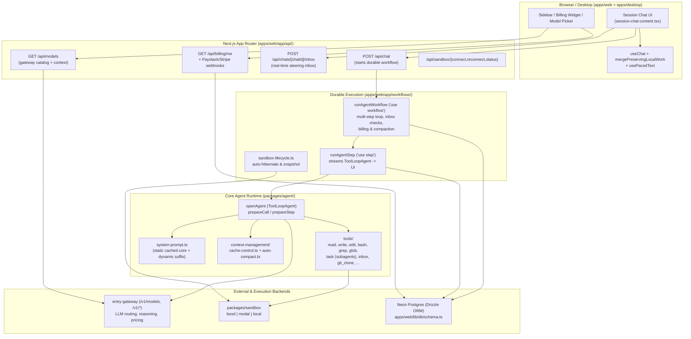

# How to Understand This Codebase

> **Start here if you are a new agent.** This document gives you a high-level visual map, data-flow diagrams, and a "where to look by task" index for the entire `entry-agents` monorepo.

---

## 1. System Architecture at a Glance



---

## 2. Monorepo Directory Map

```text
entry-agents/
├── AGENTS.md                          # Mandatory rules, CI workarounds, git/DB conventions
├── HOW_TO_UNDERSTAND_THIS_CODEBASE.md # <-- You are here
├── docs/agents/
│   ├── architecture.md                # Package-level summary
│   ├── code-style.md                  # TypeScript, Zod, Ultracite conventions
│   └── lessons-learned.md             # Living log of bugs, gotchas, and fixes
│
├── apps/
│   ├── web/                           # Next.js 16 App Router web application
│   │   ├── app/
│   │   │   ├── api/                   # REST & streaming endpoints (chat, models, billing, sandbox, auth)
│   │   │   ├── sessions/[sessionId]/  # Active session + chat pages
│   │   │   ├── workflows/             # Vercel Workflow SDK durable workflows (chat.ts, sandbox-lifecycle.ts)
│   │   │   └── types.ts               # WebAgentUIMessage, WebAgentMessageMetadata, WebAgentStepCostBreakdown
│   │   ├── components/                # React UI (chat feed, composer, model picker, usage pill, billing widget)
│   │   ├── hooks/                     # Client hooks (use-paced-text.ts, use-session-chats.ts, etc.)
│   │   └── lib/
│   │       ├── auth/                  # Better Auth (Vercel + GitHub OAuth)
│   │       ├── billing/               # Plans, credit-ledger.ts, process-charge.ts
│   │       ├── chat/                  # merge-preserving-local-work.ts, dedupe-message-reasoning.ts
│   │       ├── db/                    # Drizzle schema.ts, queries, migrations/
│   │       ├── models-with-context.ts # Live entry-gateway /v1/models fetcher + reasoning/context parser
│   │       └── model-reasoning.ts     # Reasoning effort validation & providerOptions mapping
│   └── desktop/                       # Tauri desktop client wrapping the web app + local icons/resources
│
└── packages/
    ├── agent/                         # @entry-agents/agent — ToolLoopAgent, tools, prompts, context
    │   ├── open-agent.ts              # Main ToolLoopAgent definition, callOptionsSchema, prepareCall/prepareStep
    │   ├── system-prompt.ts           # Static core prompt + model family overlays + dynamic environment suffix
    │   ├── models.ts                  # sharedProvider() gateway client + Anthropic/Gemini/OpenAI adapters
    │   ├── context-management/        # cache-control.ts (Anthropic breakpoints) + auto-compact.ts
    │   ├── subagents/                 # explorer (read-only) & executor (full-access) definitions
    │   └── tools/                     # All agent tools (read, write, edit, bash, git_clone, inbox, task, etc.)
    ├── sandbox/                       # @entry-agents/sandbox — Provider registry (boxd, modal, local)
    └── shared/                        # @entry-agents/shared — Shared helpers across packages
```

---

## 3. End-to-End Chat & Streaming Lifecycle

```text
User submits prompt
  │
  ▼
[apps/web/components/session-chat-content.tsx]
  │  POST /api/chat
  ▼
[apps/web/app/workflows/chat.ts -> runAgentWorkflow ("use workflow")]
  │  1. Resolves model & pricing catalog from entry-gateway (60s TTL cache)
  │  2. Checks credit balance & usage window allowance (billing/credit-ledger.ts)
  │  3. Loops steps until stop or budget exhausted:
  │     ├─ Checks chat_steering_inbox for unread steering messages
  │     └─ Calls runAgentStep ("use step")
  │          │
  │          ▼
  │     [packages/agent/open-agent.ts -> openAgent.stream()]
  │       ├─ buildSystemPromptParts() -> [static cached core, dynamic env/branch/skills]
  │       ├─ addCacheControl() -> Anthropic breakpoints on static prompt, last tool, messages
  │       ├─ maybeCompactMessages() -> auto-compact at 95% of model context_window
  │       └─ Tool execution -> Sandbox (boxd / modal / local)
  │          │
  │          ▼
  │     SSE Stream -> UIMessageStream
  │       ├─ Emits live messageMetadata (usage, stepBreakdown, TPS, cost)
  │       └─ Persists atomic message + clears activeStreamId in Postgres
  ▼
[Client UI]
  ├─ mergePreservingLocalWork() combines server snapshots + local stream monotonically
  ├─ usePacedText() reveals text smoothly on requestAnimationFrame
  └─ MessageModelPill displays model, cost, tokens, TPS, and per-step breakdown
```

---

## 4. Key Architectural Invariants

1. **Capabilities, never provider names**: `packages/sandbox` exposes `SandboxCapabilities`. UI, workflows, and agent tools must check capability flags rather than branching on `"boxd"` or `"modal"`.
2. **Gateway is the source of truth for models**: Context windows, pricing (`cost`), supported reasoning efforts, and default reasoning effort come from `entry-gateway` (`/v1/models`) via `apps/web/lib/models-with-context.ts`. Never hardcode model-family context limits.
3. **Workflow serialization boundary**: Functions marked `"use workflow"` cannot pass closures or non-serializable objects into `"use step"` functions. Host hooks (`inboxHooks`, `sandboxLifecycleHooks`, `github`, `vercel`) must be constructed inside the step (`runAgentStep`), not in `runAgentWorkflow`.
4. **Prompt caching stability**: `CORE_SYSTEM_PROMPT` + model family overlay (~10.5K+ tokens) is static and cached separately from dynamic per-turn context (date, cwd, branch, custom instructions, skills) so Turn 2 Step 1 always hits the cache.
5. **Monotonic client-server merges**: During streaming, `mergePreservingLocalWork()` must never overwrite populated local `parts` or higher/newer `metadata` (`totalMessageUsage`, `totalMessageCost`, `stepBreakdown`, `tps`) with a stale server snapshot.
6. **UTC billing math**: Subscription expiration (`expiresAt`) and cycle boundaries (`addOneCalendarMonth`) are computed in UTC (`Date.UTC`) and must be formatted with `timeZone: "UTC"`.

---

## 5. Where to Look by Task

| If you are working on... | Start in these files |
| --- | --- |
| **Chat UI, scroll, composer, attachments** | `apps/web/components/session-chat-content.tsx`, `apps/web/hooks/use-paced-text.ts`, `apps/web/lib/chat/merge-preserving-local-work.ts` |
| **Model picker, reasoning effort, context window** | `apps/web/lib/models-with-context.ts`, `apps/web/lib/model-reasoning.ts`, `apps/web/lib/model-options.ts`, `apps/web/components/model-selector-compact.tsx` |
| **Usage pill, cost breakdown, TPS** | `apps/web/components/message-model-pill.tsx`, `apps/web/app/types.ts`, `apps/web/app/workflows/chat.ts` |
| **Agent tools & subagents** | `packages/agent/open-agent.ts`, `packages/agent/tools/`, `packages/agent/subagents/` |
| **System prompt & prompt caching** | `packages/agent/system-prompt.ts`, `packages/agent/context-management/cache-control.ts`, `packages/agent/context-management/auto-compact.ts` |
| **Steering inbox vs queued prompts** | `apps/web/app/workflows/chat.ts`, `packages/agent/tools/inbox.ts`, `apps/web/lib/db/schema.ts` (`chat_steering_inbox`) |
| **Sandbox providers & background processes** | `packages/sandbox/registry.ts`, `packages/sandbox/process-registry.ts`, `packages/agent/tools/process.ts` |
| **Billing, credits, subscriptions, usage windows** | `apps/web/lib/billing/plans.ts`, `apps/web/lib/billing/credit-ledger.ts`, `apps/web/lib/billing/process-charge.ts`, `apps/web/components/sidebar-billing-widget.tsx` |
| **Database schema & migrations** | `apps/web/lib/db/schema.ts`, `apps/web/lib/db/migrations/` (run `pnpm --dir apps/web db:generate`) |
