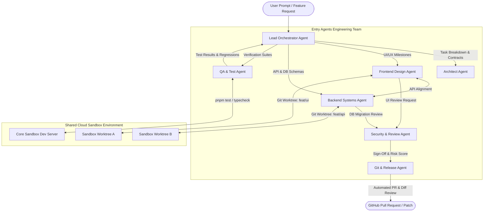
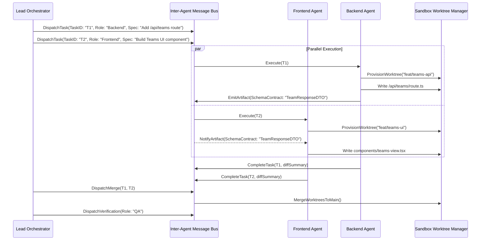
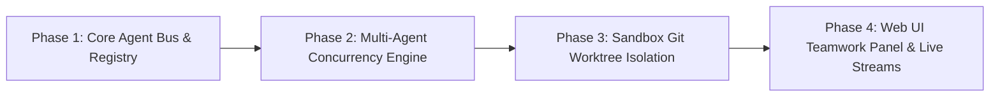

# Entry Agents Multi-Agent Collaborative System — Architecture & Engineering Blueprint

## Executive Summary & Vision

The core identity of **Entry Agents** is defined by its plural name: a collaborative platform where multiple autonomous, specialized AI agents act as a coordinated engineering team. While conversational coding assistants operate as single sequential loops, production software engineering requires specialized skill sets operating concurrently: architectural planning, frontend craftsmanship, backend robustness, automated testing, security auditing, and release management.

This blueprint details the end-to-end architecture to elevate Entry from single-subagent task delegation into a **First-Class Multi-Agent Collaborative Platform**.



---

## 1. Core Architectural Pillars

### 1.1 The Multi-Agent Role Hierarchy
Instead of generic model calls with identical system prompts, Entry Agents defines specialized personas with scoped system instructions, restricted toolsets, and distinct reasoning profiles:

| Agent Role | Model Profile | Toolset | Core Responsibility |
| :--- | :--- | :--- | :--- |
| **Lead Orchestrator** | High-reasoning (Claude 3.7 / Gemini 2.5 Pro) | `task`, `askUser`, `todo`, `read` | Deconstructs user intent into an execution DAG; delegates milestones; arbitrates conflicts; tracks overall budget. |
| **System Architect** | High-reasoning (Deep reasoning) | `read`, `glob`, `grep`, `webSearch` | Analyzes codebase structure; authors system blueprints, interface contracts, and database schema migrations. |
| **Frontend Designer** | Creative/Vision-capable (Claude 3.5 Sonnet) | `read`, `write`, `edit`, `devServer` | Crafts distinctive, high-polish UI components using Tailwind, Radix, and Framer Motion; avoids generic AI templates. |
| **Backend Engineer** | Precise code generation | `read`, `write`, `edit`, `bash` | Implements server actions, REST/GraphQL endpoints, database adapters, and business logic. |
| **QA & Verification** | Fast, deterministic | `bash`, `read`, `grep` | Executes `pnpm typecheck`, unit tests, lint checks, and reproduces edge-case bugs in sandbox terminal. |
| **Security & Reviewer** | Analytical & conservative | `read`, `grep`, `gitDiff` | Inspects all uncommitted diffs for security vulnerabilities, API key leaks, AST smells, and missing test coverage. |
| **Release & Git Agent** | Structured & conventional | `git_cli`, `github_api`, `commitAndPush` | Stages changes, writes atomic conventional commit messages, rebases branches, and drafts rich PR descriptions. |

---

## 2. Multi-Agent Concurrency & Communication Engine

### 2.1 Asynchronous Agent Communication Bus (A-Bus)
Agents do not talk directly via messy prompt concatenations. Instead, they communicate over a structured, typed message bus inside the workflow:



### 2.2 Agent Protocol Types (`packages/agent/team/types.ts`)
```typescript
export interface AgentMessage {
  id: string;
  senderRole: SubagentType | "lead";
  recipientRole: SubagentType | "lead" | "broadcast";
  type: "task_assignment" | "status_update" | "artifact_share" | "review_request" | "blocker";
  payload: {
    taskId?: string;
    description: string;
    artifacts?: Array<{ name: string; path: string; mimeType: string }>;
    diffPreview?: string;
    questions?: string[];
  };
  timestamp: number;
}
```

---

## 3. Workspace Sandbox Isolation: Git Worktrees

### 3.1 The Multi-Agent Race Condition Problem
When multiple agents edit the same sandbox directory simultaneously, file write collisions, broken git index locks (`.git/index.lock`), and turbulent build reloads occur.

### 3.2 The Solution: Isolated Worktrees per Agent
The `@entry-agents/sandbox` provider provisions temporary git worktrees within the same sandbox container:

$$\text{Workspace Root: } \texttt{/data/workspace/repo}$$
$$\text{Frontend Worktree: } \texttt{/data/workspace/worktrees/agent-frontend} \longrightarrow \texttt{feat/ui-v1}$$
$$\text{Backend Worktree: } \texttt{/data/workspace/worktrees/agent-backend} \longrightarrow \texttt{feat/api-v1}$$

- Each agent edits in isolation with zero write contention.
- The **QA Agent** merges feature branches into a staging branch and runs test suites (`pnpm test`, `next build`).
- Once verified, the **Git Release Agent** merges the staging branch cleanly into HEAD.

---

## 4. UI/UX: The Entry Agents Team Dashboard

To match the clean, professional aesthetics of desktop agent IDEs, Entry's UI will feature a dedicated **Teamwork View** in both the chat feed and the right-column workspace.

```
+---------------------------------------------------------------------------------------------------------+
| [Antigravity Header]   Session: Vercel & GitHub Multi-Agent Pipeline                     [Tabs] [x]     |
+----------------------+---------------------------------------------------+------------------------------+
| SIDEBAR              | CENTER: CONVERSATION & AGENT ORCHESTRATION        | RIGHT: WORKSPACE & CANVAS    |
|                      |                                                   |                              |
| + New Conversation   | [User Prompt Card]                                | [Review] [Preview] [Teamwork]|
|                      | "Build a collaborative team billing system"       | ---------------------------- |
| Projects             |                                                   | ACTIVE AGENTS (3 running)    |
|  * entry-agents      | [Lead Orchestrator]                               |                              |
|                      | "I have broken down the feature into 3 milestones | * Architect: Planning DB     |
| Conversations        | and dispatched the team:"                         |   [Tokens: 4.2k | Cost: $0.02|
|  * Team Billing  now |                                                   |                              |
|  * Colab MCP     7d  | +- Agent Team Activity -------------------------+ | * Frontend: Building UI      |
|  * Train A50     10d | | > Frontend Agent: Scaffolding TeamCard.tsx    | |   [Branch: feat/ui-cards]    |
|                      | | > Backend Agent:  Writing Drizzle migration    | |   [3 files modified]       |
|                      | | > QA Agent:       Waiting on migration commit  | |                              |
|                      | +------------------------------------------------+ | * Backend: Schema Drizzle    |
|                      |                                                   |   [Running migration step]   |
|                      | [Assistant Response & Diff Previews]              |                              |
|                      |                                                   | ---------------------------- |
|                      | [Floating Input Dock: Model Pill | Send]          | [Live Sandbox Terminal Output]
+----------------------+---------------------------------------------------+------------------------------+
```

### 4.1 Key Visual Components for Multi-Agent UI
1. **Agent Team Activity Pill Bar**: Displays active agent avatars, roles, current tools being run (`read`, `edit`, `bash`), and pulsing activity indicators.
2. **Teamwork Workspace Tab**: A dedicated tab in the 3rd column that visualizes the task dependency graph (DAG), branch worktrees, and per-agent token/spend allocation.
3. **Agent Inter-Dialogue Inspection**: Users can expand any agent card to see the private reasoning and internal queries between the Lead Orchestrator and the worker agents.

---

## 5. Token & Cost Governance for Multiple Agents

Multi-agent systems can rapidly exhaust token budgets if left unmonitored. Entry Agents enforces strict multi-tier spending controls:

1. **Turn-Level Pool Budgeting**:
   - The user's per-turn budget (e.g. $5.00 limit) is shared across the entire team via the existing `SubagentBudgetGuard`.
   - Before an agent launches, the Orchestrator assigns a **capped token allowance** (e.g., Architect: 15%, Frontend: 40%, Backend: 30%, QA: 15%).
2. **Early Termination on Blocker**:
   - If the Architect or QA Agent identifies an unresolvable structural error or missing prerequisite, all dependent agents are cancelled immediately to conserve funds.
3. **Context Window Compaction per Agent**:
   - Each subagent runs its own independent context window; bulky tool outputs from one agent do not pollute another agent's context.

---

## 6. Implementation Roadmap



### Phase 1: Core Agent Bus & Registry Expansion (`packages/agent`)
- Expand `SUBAGENT_REGISTRY` to include `architect`, `backend`, and `qa`.
- Add typed event schemas for Inter-Agent Messages in `packages/agent/team/`.
- Introduce `runMultiAgentStep` orchestration primitive.

### Phase 2: Multi-Agent Concurrency Engine (`apps/web/app/workflows`)
- Enhance `apps/web/app/workflows/chat.ts` to support `Promise.allSettled` execution of independent task nodes in the DAG.
- Connect per-agent usage counters directly into Entry's real-time billing ledger (`recordBillableUsage`).

### Phase 3: Sandbox Worktree Isolation (`@entry-agents/sandbox`)
- Implement `createWorktree(branchName)` and `cleanupWorktree(branchName)` in Boxd, Modal, and Novita providers.
- Provide automatic three-way merge resolution for completed subagent branches.

### Phase 4: UI Teamwork Dashboard (`apps/web`)
- Create `<WorkspaceTeamworkTab />` in the 3rd column workspace panel.
- Build live multi-agent streaming chips in `<SessionChatContent />`.
- Add interactive agent pause, inspect, and redirect controls.
